<picture>
  <source media="(prefers-color-scheme: dark)" srcset="https://raw.githubusercontent.com/Likhons/Likhons/main/assets/header-dark.svg">
  
</picture>

So far that has meant online stores that take real orders, land records nobody can quietly edit, and APIs that keep the rules on the server. Lately it means AI agent security: stopping agents from acting on instructions hidden in what they read.

I've just completed a B.Sc. in Computer Science & Engineering at Daffodil International University, and I'm based in Dhaka, looking for an entry-level software engineering role.

## Selected work

### LandLock

Stops one plot of land from being sold twice, and keeps a signed record nobody can quietly edit. Built at the LandTech 2026 hackathon at DIU, where I led a team of two.

In Bangladesh a land sale passes through two separate offices, and fraud slips into the gap between them. LandLock locks a plot the moment a sale starts and blocks a second sale or mortgage on the same land.

- Twenty sale requests on one plot at the same moment: exactly one goes through.
- Every land event is chained with SHA-256 and signed with Ed25519, so an edited, deleted or reordered record is detected.
- Deeds never followed by mutation (namjari) are flagged, and every receipt has a QR code anyone can scan to check it is genuine.

*React, Vite, Node.js, Express and Node crypto, deployed on Vercel and Render.* 
[Case study](https://likhon.me/work/landlock) · [Live site](https://landlock-flame.vercel.app/)

### WAEZ

An online clothing store I built, with its admin panel, for WAEZ, a Bangladeshi clothing label. Catalog, cart, wishlist and checkout by bKash or cash on delivery, with orders tracked from New to Delivered.

- The server fetches prices from the database and ignores any price the browser sends.
- A bKash Transaction ID can be used only once, to prevent duplicate orders and fraud.
- Only customers with a delivered order can write a review.
- Uploaded photos are converted to WebP and stripped of camera and GPS data.

*React, React Router, Vite, Node.js, Express, PostgreSQL and JWT, with Cloudinary, Render and Neon.* 
[Case study](https://likhon.me/work/waez) · [Live store](https://waez.onrender.com/) (free hosting, so the first load can be slow)

### Also built

- **[AgentShield](https://likhon.me/work/agentshield)**: a runtime security gateway that stops AI agents from acting on hidden instructions in Bangla, Banglish or English. On a real LLM agent, 20 attacks moved money 4 times without it and 0 times with it. [Source](https://github.com/Likhons/AgentShield)
- **[AlumniLink](https://likhon.me/work/alumnilink)**: connects DIU students with verified alumni for job referrals and one-to-one career mentorship. An independent student project, not an official DIU service.
- **[STEP Comilla](https://likhon.me/work/step-comilla)**: an online store and shop point of sale for an authorised STEP footwear retailer. The counter and the website sell from one stock, counted per size, so nothing is sold twice.

## Stack

<table>
  <tr><td>Frontend</td><td>TypeScript, React, Next.js, React Router, Tailwind CSS, Vite</td></tr>
  <tr><td>Backend</td><td>Node.js, Express, REST APIs, JWT; Python, FastAPI, Pydantic</td></tr>
  <tr><td>Data</td><td>PostgreSQL, MySQL, SQLite, Prisma</td></tr>
  <tr><td>AI&nbsp;security</td><td>LLM agents and tool calling, prompt-injection defense, fine-tuning XLM-RoBERTa, Groq and Gemini APIs</td></tr>
  <tr><td>Tooling</td><td>pytest, Vitest, Playwright, GitHub Actions, Docker, Vercel, Render, Neon</td></tr>
  <tr><td>Learning</td><td>Machine learning, PyTorch and Transformers</td></tr>
</table>

## Activity

<picture>
  <source media="(prefers-color-scheme: dark)" srcset="https://streak-stats.demolab.com/?user=Likhons&card_width=880&card_height=180&border_radius=6&disable_animations=true&background=00000000&border=3D444D&stroke=3D444D&ring=73D39B&fire=73D39B&currStreakNum=F0F6FC&sideNums=F0F6FC&currStreakLabel=F0F6FC&sideLabels=F0F6FC&dates=9198A1">
  
</picture>

## How I got here

<table>
  <tr><td>Now</td><td>Looking for an entry-level software engineering role where I can keep growing and build products people use.</td></tr>
  <tr><td>2026</td><td>Finished my B.Sc. at DIU, majoring in software development. Led a team of two at the LandTech 2026 hackathon with LandLock, and built the WAEZ store.</td></tr>
  <tr><td>2025</td><td>Web development, AI and machine learning, through coursework and self-learning.</td></tr>
  <tr><td>2024</td><td>University projects, and the programming fundamentals behind them.</td></tr>
  <tr><td>2023</td><td>Started a B.Sc. in Computer Science & Engineering at Daffodil International University.</td></tr>
</table>

## Contact

Hiring for an entry-level software engineering role, or have a project in mind? Email is the quickest way to reach me.

**[wazidhasan58@gmail.com](mailto:wazidhasan58@gmail.com)** 
[likhon.me](https://likhon.me) · [CV](https://likhon.me/download-cv.pdf) · [LinkedIn](https://www.linkedin.com/in/likhons/) · [Facebook](https://www.facebook.com/Wazid.Official1) · [Instagram](https://instagram.com/hasanwazid)

 

Building, learning and growing one commit at a time.
