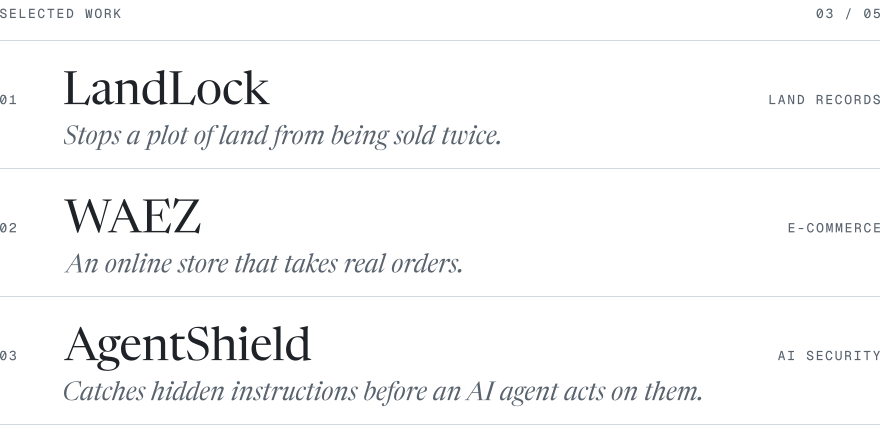

<picture>
  <source media="(prefers-color-scheme: dark)" srcset="https://raw.githubusercontent.com/Likhons/Likhons/main/assets/header-dark.svg">
  
</picture>

 

<picture>
  <source media="(prefers-color-scheme: dark)" srcset="https://raw.githubusercontent.com/Likhons/Likhons/main/assets/work-dark.svg">
  
</picture>

Case studies: [LandLock](https://likhon.me/work/landlock) · [WAEZ](https://likhon.me/work/waez) · [AgentShield](https://likhon.me/work/agentshield) · [all work](https://likhon.me/#portfolio)

 

<picture>
  <source media="(prefers-color-scheme: dark)" srcset="https://streak-stats.demolab.com/?user=Likhons&card_width=880&card_height=180&border_radius=6&background=00000000&border=3D444D&stroke=3D444D&ring=73D39B&fire=73D39B&currStreakNum=F0F6FC&sideNums=F0F6FC&currStreakLabel=F0F6FC&sideLabels=F0F6FC&dates=9198A1">
  
</picture>

 

[likhon.me](https://likhon.me) · [LinkedIn](https://www.linkedin.com/in/likhons/) · [Email](mailto:wazidhasan58@gmail.com) · [CV](https://likhon.me/download-cv.pdf) · [Facebook](https://www.facebook.com/Wazid.Official1) · [Instagram](https://instagram.com/hasanwazid)
