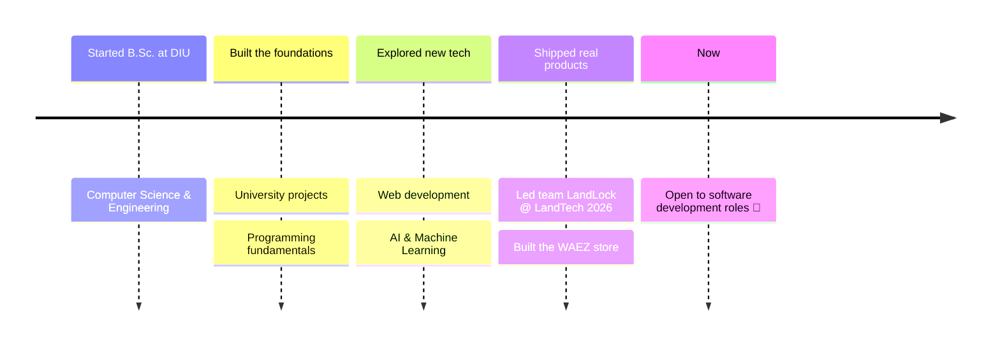

<!-- ═══════════════════════════ HEADER ═══════════════════════════ -->

<!-- ═══════════════════════════ WAVING AVATAR ═══════════════════════════ -->

  

 

 

<!-- ═══════════════════════════ TERMINAL INTRO ═══════════════════════════ -->

  

 

<!-- ═══════════════════════════ TECH STACK ═══════════════════════════ -->
<h2 align="center"> Tech Arsenal</h2>

**Frontend** 

**Backend & Data** 

**Tools & Cloud** 

➕ JWT · REST APIs · Node crypto · Cloudinary · Render · Neon &nbsp;|&nbsp; 🧠 currently exploring <b>AI & Machine Learning</b>

<!-- ═══════════════════════════ STATS ═══════════════════════════ -->
<h2 align="center"> Commit Energy</h2>

  
  

<!-- ═══════════════════════════ SNAKE ═══════════════════════════ -->

  <picture>
    <source media="(prefers-color-scheme: dark)" srcset="https://raw.githubusercontent.com/Likhons/Likhons/output/github-snake-dark.svg"/>
    <source media="(prefers-color-scheme: light)" srcset="https://raw.githubusercontent.com/Likhons/Likhons/output/github-snake.svg"/>
    
  </picture>

<!-- ═══════════════════════════ JOURNEY ═══════════════════════════ -->
<h2 align="center"> The Journey So Far</h2>

<!-- ═══════════════════════════ CONNECT ═══════════════════════════ -->
<h2 align="center"> Let's Build Something Amazing Together</h2>

Hiring for a software development role, or have a project in mind? My inbox is open.

